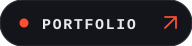
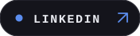
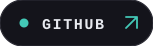
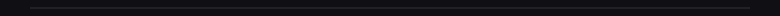
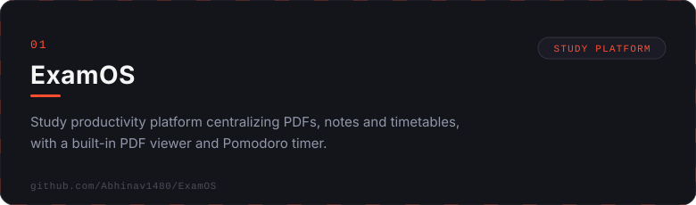
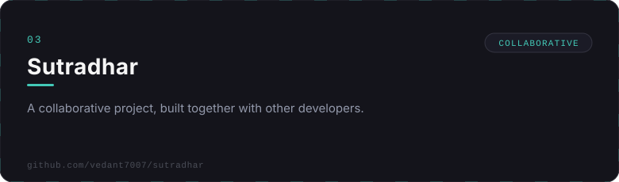

<!-- README.md — Abhinav1480/Abhinav1480 profile repo
     Dark charcoal + crimson design system. Every static asset is a
     hand-generated SVG from scripts/generate_svgs.py and render3d.py —
     the 3D scenes are real software-rendered geometry baked into SMIL
     animation flipbooks (GitHub strips JS/CSS from READMEs, so the motion
     lives inside the SVGs themselves). The interactive WebGL version of
     this same world lives on GitHub Pages: abhinav1480.github.io/Abhinav1480 -->

 

<!-- profile views: live counter from hits.dwyl.com -->

 

<!-- link buttons: hand-built SVG pills, same height, consistent radii -->

&nbsp;

&nbsp;

  

<!-- interactive 3D: a real Three.js/WebGL version of this crystal world,
     served from this same repo via GitHub Pages. -->

---

## 
About

I'm **Abhinav Nakka**, a third-year **B.Tech Computer Science** student at
**Vidya Jyothi Institute of Technology (VJIT), Hyderabad**.

I build full-stack web apps and care just as much about how an interface
*feels* as how it works — component systems, motion, and 3D web are where I
spend most of my time. I'm currently exploring the seams between
**3D web**, **AI-assisted development**, and **cloud**.

**Currently exploring**

<kbd>3D Web</kbd> &nbsp; <kbd>AI</kbd> &nbsp; <kbd>Cloud</kbd>

## 
Tech Stack

**Programming Languages**
 

 
Java &nbsp;·&nbsp; JavaScript &nbsp;·&nbsp; TypeScript &nbsp;·&nbsp; Python &nbsp;·&nbsp; C &nbsp;·&nbsp; HTML5 &nbsp;·&nbsp; CSS3 &nbsp;·&nbsp; SQL

  

**Frontend**
 

 
React.js &nbsp;·&nbsp; Next.js &nbsp;·&nbsp; Tailwind CSS &nbsp;·&nbsp; Three.js &nbsp;·&nbsp; GSAP

  

**Backend**
 

 
Node.js &nbsp;·&nbsp; Express.js &nbsp;·&nbsp; MongoDB &nbsp;·&nbsp; Firebase

  

**Cloud &amp; DevOps**
 

 
AWS &nbsp;·&nbsp; Git &nbsp;·&nbsp; GitHub &nbsp;·&nbsp; Vercel &nbsp;·&nbsp; Render &nbsp;·&nbsp; Docker

  

**Design &amp; Creative Development**
 

 
Figma &nbsp;·&nbsp; Spline

## 
Projects

<!-- Project cards: 840x280 SVGs with a real software-rendered extruded 3D
     number on each card (rotation baked as a SMIL flipbook), animated crimson
     border, orbiting accent rings and a sheen sweep. Live / Source link rows
     sit beneath each card as plain  links so the cards stay uniform. -->

 

  <a href="https://exam-os-seven.vercel.app/" target="_blank" rel="noopener"><b>● Live</b></a>
  &nbsp;·&nbsp;
  <a href="https://github.com/Abhinav1480/ExamOS" target="_blank" rel="noopener">Source</a>

   

<!-- // TODO: add repo link — Gym Beast has no public repo yet; fill it in below when it exists -->

 

  <b style="color:#9298AA">○ Repo link coming soon</b>

   

<!-- Please verify my role / contributions in this collaborative repo before publishing -->

 

  <a href="https://github.com/vedant7007/sutradhar" target="_blank" rel="noopener">Source</a>

   

<!-- Please verify my role / contributions in this hackathon repo before publishing -->

 

  <a href="https://github.com/vedant7007/clinic-desk" target="_blank" rel="noopener">Source</a>

## 
Community &amp; Hackathons

Communities I'm part of
  

&nbsp;

&nbsp;

   

Hackathons I've participated in
  

<!-- The win is featured deliberately — everything below is a participation or
     placement the user actually listed; nothing is invented. -->

  

&nbsp;

 

&nbsp;

 

&nbsp;

&nbsp;

## 
GitHub Activity

<!-- profile-details card from the live github-profile-summary-cards API (contains
     the contribution calendar). The profile-summary-cards.yml workflow also writes
     a themed copy into /assets as an in-repo archive. -->

  

  

<!-- contribution snake: Platane/snk, regenerated daily by .github/workflows/snake.yml.
     <picture> picks the dark or light variant per viewer theme -->
<picture>
  <source media="(prefers-color-scheme: dark)" srcset="https://raw.githubusercontent.com/Abhinav1480/Abhinav1480/main/assets/github-snake-dark.svg" />
  <source media="(prefers-color-scheme: light)" srcset="https://raw.githubusercontent.com/Abhinav1480/Abhinav1480/main/assets/github-snake.svg" />
  
</picture>

## 
Recent Activity

<!-- jamesgeorge007/github-activity-readme fills this block automatically.
     Do not delete the START/END markers or the workflow has nowhere to write. -->

<!--START_SECTION:activity-->
Recent activity appears here after the `recent-activity.yml` workflow runs once — followed by the README setup steps in SETUP.md.
<!--END_SECTION:activity-->

## 
Let's Connect

  

&nbsp;

&nbsp;

---

Built with a custom 3D design system — real software-rendered geometry from <a href="https://github.com/Abhinav1480/Abhinav1480/blob/main/scripts/render3d.py">scripts/render3d.py</a> baked into SMIL flipbooks, plus a live <a href="https://abhinav1480.github.io/Abhinav1480/">WebGL version</a>. See <a href="https://github.com/Abhinav1480/Abhinav1480/blob/main/SETUP.md">SETUP.md</a>.

